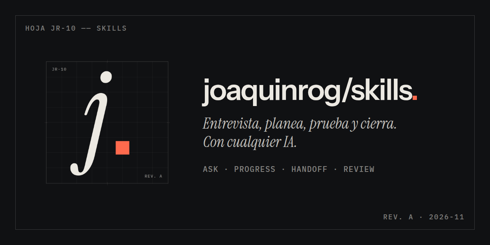
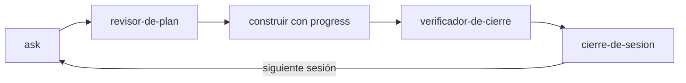

<p align="center">
  
</p>

<p align="center">
  
  
</p>

**Mis skills para trabajar con IA como un equipo serio, no a puro vibe coding.** Entrevistar antes de
planear, revisar el plan, probar lo que funciona y cerrar cada sesión para que la siguiente arranque
sin depender de la memoria de nadie. Funcionan con cualquier modelo: lo que vale vive en archivos
tuyos, no en una app.

*[English below](#english)*

## Instálalo en 30 segundos

Pégale esto a tu agente (Claude Code, Codex, Gemini CLI, OpenCode, Cursor, Copilot…):

```text
Instala las skills de github.com/joaquinrog/skills siguiendo su INSTALL.md
```

Él corre los comandos, te ofrece compañeras como `find-skills` y te dice qué quedó. Nada de clonar.

<details>
<summary><strong>Prefiero el comando</strong></summary>

**Claude Code** (plugin, se actualiza solo):

```text
/plugin marketplace add joaquinrog/skills
/plugin install skills@joaquinrog
```

**Cualquier otro agente:**

```bash
npx skills@latest add joaquinrog/skills
```

El instalador detecta tus agentes y te deja elegir. Para actualizar: `npx skills@latest update`.

</details>

Después escribe **`/ask`** o simplemente *"planea X"*.

## Qué problema resuelve cada una

**1. El agente no hizo lo que querías.** El pedido era vago y nadie preguntó.
→ [`ask`](skills/ask/SKILL.md) te entrevista antes de planear: solo preguntas que cambian el plan,
cada una con una opción recomendada. Distingue proyecto nuevo, feature y pivote, y entrega el plan
en `.md` con diagramas Mermaid.

**2. "Ya quedó"… y no quedó.** El agente dice que terminó y nadie lo comprobó.
→ [`progress`](skills/progress/SKILL.md) guarda en `progress.json` cada historia con el comando que
la prueba. `passes` solo lo escribe el script al correrlo, nunca un agente a mano. Una prueba
saltada no cuenta.

**3. Mañana nadie se acuerda.** La sesión se acabó y el contexto se perdió.
→ [`cierre-de-sesion`](skills/cierre-de-sesion/SKILL.md) reescribe el `HANDOFF.md`, corre
`progress` y propone cómo evitar los errores de hoy. Cualquier agente o persona retoma leyendo un
archivo.

**4. Quien escribió el código no ve sus propios errores.**
→ Dos agentes, para tu modelo más fuerte: [`revisor-de-plan`](agents/revisor-de-plan.md) critica el
plan antes del código, y [`verificador-de-cierre`](agents/verificador-de-cierre.md) comprueba con
evidencia (pruebas, diff, `progress.json`) que lo pedido sí quedó.

**¿Por dónde empiezo?** → [`usando-el-kit`](skills/usando-el-kit/SKILL.md) explica el ciclo y qué
toca en cada paso.



No todo necesita el ciclo completo: un ajuste chico va directo con su prueba; un feature usa
`ask → progress → cierre`; lo grande o sin supervisión usa todo.

## Elige tu modelo

Los agentes revisores no fijan un modelo: piden **el más fuerte que tengas**, ideal uno distinto al
que escribió el código. En Claude Code agrega `model: opus` a una copia en `~/.claude/agents/`; en
OpenCode ponle cualquier modelo de cualquier proveedor en `opencode.json`; en Codex, `-m <modelo>`.

## Extras

- [Hook de plan mode](extras/plan-mode-hook/) (solo Claude Code): carga `ask` sola antes de
  presentar un plan.
- Pruebas: `python3 -m unittest discover tests`.

---

<a id="english"></a>
<details>
<summary><strong>English</strong></summary>

My skills for working with AI like a serious team, not just vibe coding: **interview before
planning, review the plan, prove what works and close every session.** Works with any model. The
skills are written in Spanish; their descriptions are bilingual.

**Install in 30 seconds:** paste this into your agent (Claude Code, Codex, Gemini CLI, OpenCode,
Cursor, Copilot…):

```text
Install the skills from github.com/joaquinrog/skills following its INSTALL.md
```

Or: `/plugin marketplace add joaquinrog/skills` + `/plugin install skills@joaquinrog` in Claude
Code, or `npx skills@latest add joaquinrog/skills` anywhere else.

| Skill | Fixes |
|---|---|
| `ask` | The agent didn't do what you wanted: it interviews you first |
| `progress` | "Done" that isn't: only a script writes `passes` |
| `cierre-de-sesion` | Lost context: rewrites `HANDOFF.md` for the next session |
| `revisor-de-plan`, `verificador-de-cierre` | Authors miss their own bugs: run on your strongest model |

</details>

## Licencia

MIT © Joaquín Rosales · [joaq.mx](https://joaq.mx)
