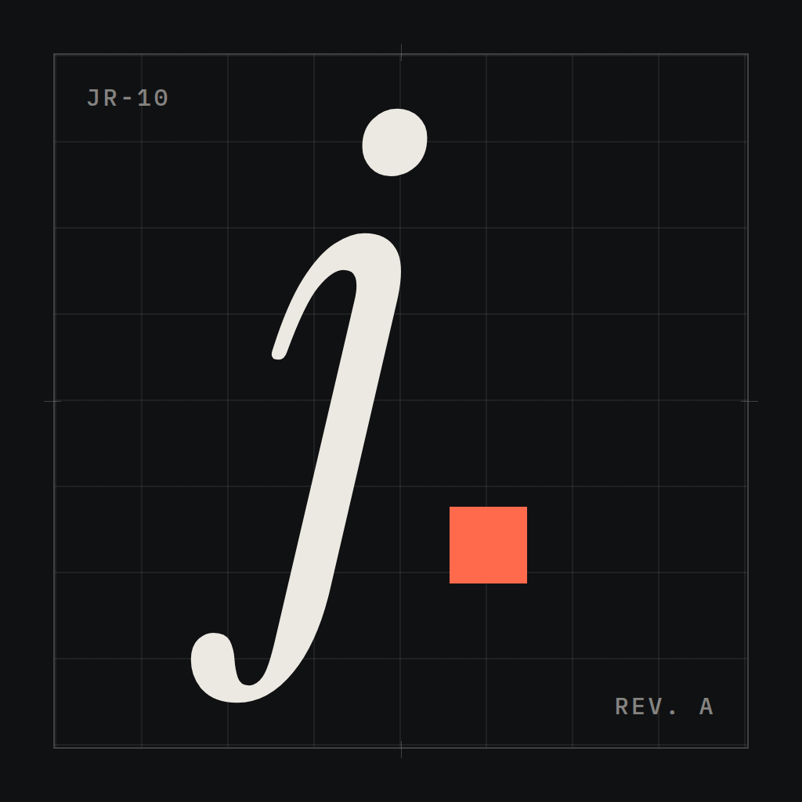
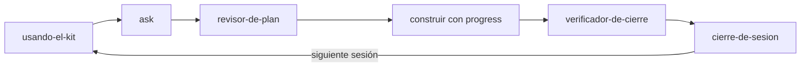

<p align="center"></p>

# skills · Joaquín Rosales

**[Español](#español) · [English](#english)**

Un kit para trabajar con IA como un equipo serio: **entrevistar antes de planear, revisar el plan,
probar lo que funciona y cerrar cada sesión** para que la siguiente arranque sin depender de la
memoria de nadie. Funciona en Claude Code y en cualquier agente que lea el estándar abierto de
[Agent Skills](https://agentskills.io) (`SKILL.md`): Codex, OpenCode, Gemini CLI y otros.

---

## Español

### Qué trae

| Pieza | Tipo | Qué hace |
|---|---|---|
| [`usando-el-kit`](skills/usando-el-kit/SKILL.md) | skill | Punto de entrada: el ciclo de trabajo y qué toca en cada paso |
| [`ask`](skills/ask/SKILL.md) | skill | Entrevista antes de planear: solo preguntas necesarias, cada una con opción recomendada. Distingue proyecto nuevo, feature y pivote. Entrega el plan en `.md` con diagramas Mermaid |
| [`progress`](skills/progress/SKILL.md) | skill + script | `progress.json`: cada historia con el comando que la prueba. `passes` solo lo escribe el script, nunca un agente a mano |
| [`cierre-de-sesion`](skills/cierre-de-sesion/SKILL.md) | skill | Corre progress, reescribe el `HANDOFF.md`, propone decisiones y una retro de errores |
| [`revisor-de-plan`](agents/revisor-de-plan.md) | agente | Critica el plan antes de escribir código, con evidencia del repo |
| [`verificador-de-cierre`](agents/verificador-de-cierre.md) | agente | Comprueba con evidencia que lo pedido sí quedó, en vez de creerle a la sesión |
| [Hook de plan mode](extras/plan-mode-hook/) | extra, solo Claude Code | Carga `ask` sola antes de presentar un plan |

### El ciclo



No todo necesita el ciclo completo: un ajuste chico va directo con su prueba; un feature usa
`ask → progress → cierre`; algo grande o sin supervisión usa todo.

### Guía de instalación (Setup Guide)

**Claude Code** (como plugin, un comando):

```
/plugin marketplace add joaquinrog/skills
/plugin install skills@joaquinrog
```

Reinicia la sesión y escribe `/skills` o pide "usa ask para planear X".

**Codex, ChatGPT y otros agentes con Agent Skills:** copia las carpetas de `skills/` a la carpeta de
skills de tu herramienta. Codex busca en `.agents/skills/` (del proyecto) o en tu carpeta de usuario;
Gemini CLI en `.gemini/skills/`; GitHub Copilot en `.github/skills/`. Revisa la documentación de tu
herramienta: el formato es el mismo, la carpeta cambia.

```bash
git clone https://github.com/joaquinrog/skills
mkdir -p .agents/skills && cp -r skills/skills/* .agents/skills/
```

**Los agentes** (`revisor-de-plan`, `verificador-de-cierre`): en Claude Code vienen con el plugin.
En otras herramientas, usa su texto como subagente o como prompt de una sesión aparte.

**`progress`:** copia `skills/progress/scripts/progress_check.py` a tu repo. Solo necesita Python 3.9+.

```bash
python3 tools/progress_check.py            # corre todos los progress.json
python3 tools/progress_check.py --dry-run  # reporta sin escribir
```

### Elige tu modelo (no dependas de uno)

Los agentes no fijan un modelo: piden **el más fuerte que tengas**, porque revisa mejor quien no
escribió el código. Fíjalo según tu herramienta:

- **Claude Code:** copia el agente a `~/.claude/agents/` y agrega `model: opus` (o tu modelo más
  fuerte) al encabezado.
- **OpenCode:** define el agente en tu `opencode.json` con el modelo que quieras, de cualquier
  proveedor (OpenAI, Google, DeepSeek, Qwen, GLM, Anthropic…).
- **Codex:** abre una sesión con `-m <modelo>` y pégale el texto del agente.

Lo que hace portable al kit es que todo vive en texto: el plan, `progress.json`, `HANDOFF.md`,
`AGENTS.md`. Si mañana cambias de modelo o de herramienta, tu sistema se queda.

### Pruebas

```bash
python3 -m unittest discover tests
```

### Licencia

MIT. Úsalo, cámbialo y compártelo.

---

## English

A kit for working with AI like a serious team: **interview before planning, review the plan,
prove what works and close every session** so the next one starts without relying on anyone's
memory. Works in Claude Code and in any agent that reads the open
[Agent Skills](https://agentskills.io) standard (`SKILL.md`): Codex, OpenCode, Gemini CLI and more.
The skills are written in Spanish; their descriptions are bilingual.

### What's inside

| Piece | Type | What it does |
|---|---|---|
| `usando-el-kit` | skill | Entry point: the work cycle and what comes next |
| `ask` | skill | Interviews you before planning: only necessary questions, each with a recommended option. Handles new projects, features and pivots. Writes the plan as `.md` with Mermaid diagrams |
| `progress` | skill + script | `progress.json`: each story with the command that proves it. Only the script writes `passes`, never an agent by hand |
| `cierre-de-sesion` | skill | Runs progress, rewrites `HANDOFF.md`, proposes decision records and a retro |
| `revisor-de-plan` | agent | Critiques the plan before code is written, with evidence from the repo |
| `verificador-de-cierre` | agent | Verifies with evidence that the work is done instead of trusting the session |
| Plan-mode hook | extra, Claude Code only | Loads `ask` before a plan is presented |

### Setup guide

**Claude Code:**

```
/plugin marketplace add joaquinrog/skills
/plugin install skills@joaquinrog
```

**Codex, ChatGPT and other Agent Skills tools:** copy the folders in `skills/` to your tool's skills
folder (Codex: `.agents/skills/`; Gemini CLI: `.gemini/skills/`; GitHub Copilot: `.github/skills/`).
Same format, different folder: check your tool's docs.

**Agents:** bundled with the Claude Code plugin. Elsewhere, use their text as a subagent or as the
prompt of a separate session.

**`progress`:** copy `skills/progress/scripts/progress_check.py` into your repo (Python 3.9+, no
dependencies).

### Pick your model (don't depend on one)

The agents don't pin a model: run them on **your strongest one**, ideally different from the model
that wrote the code. Claude Code: add `model: opus` to a copy in `~/.claude/agents/`. OpenCode: set
any provider's model in `opencode.json`. Codex: `-m <model>`.

### Tests

```bash
python3 -m unittest discover tests
```

### License

MIT.
